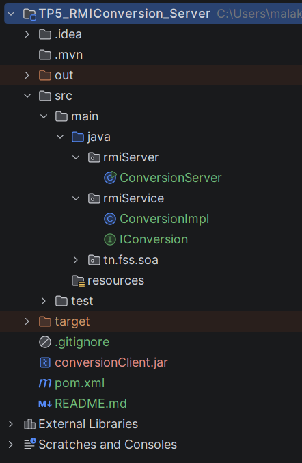
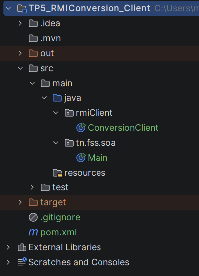
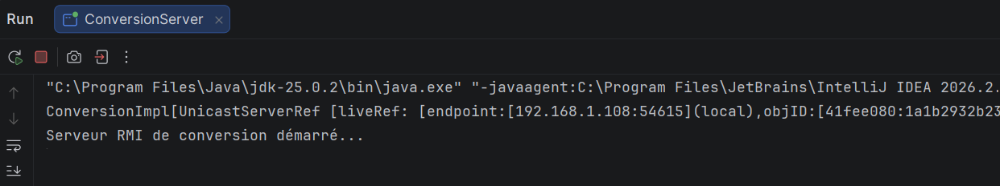
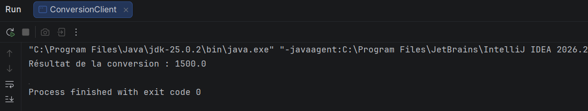

# TP 5 – Activité 5-1 : Service de conversion de devise avec Java RMI

**Étudiante :** Malak Ben Slim
**Classe :** LSI 3
**Matière :** Développement d'Applications Réparties
**Année universitaire :** 2026 – 2027
 
---
## 1. Objectif

Concevoir une application répartie en **Java RMI** (Remote Method Invocation) qui fournit un service de conversion de devise : le serveur permet au client de convertir un montant en **euros** vers le **dinar tunisien**.

Cette activité illustre le cycle de vie d'un service distant : **définition de l'interface → implémentation → enregistrement → invocation**.

## 3. Structure du dépôt

```
Malak Ben Slim_LSI3_DevAppReparties/
├── TP5_RMIConversion_Server/
│   └── src/main/java/
│       ├── rmiService/
│       │   ├── IConversion.java        (interface distante)
│       │   └── ConversionImpl.java     (implémentation du service)
│       └── rmiServer/
│           └── ConversionServer.java   (serveur : RMIRegistry + publication)
├── TP5_RMIConversion_Client/
│   └── src/main/java/
│       └── rmiClient/
│           └── ConversionClient.java   (client : lookup + invocation)
├── conversionClient.jar                (contient uniquement IConversion)
├── images/                           (imprimés écrans)
└── README.md
```

## 4. Travail réalisé

### Étape 1 : Espace de travail

Création du répertoire `Malak Ben Slim_LSI3_DevAppReparties` qui regroupe les deux projets.

### Étape 2 : Développement du serveur (`TP5_RMIConversion_Server`)

- **`IConversion`** (package `rmiService`) : interface distante qui étend `Remote` et déclare la méthode `double convertirMontant(double mt) throws RemoteException`.
- **`ConversionImpl`** (package `rmiService`) : implémente `IConversion` et étend `UnicastRemoteObject`, ce qui exporte automatiquement l'objet. La conversion applique un taux de 3 (1 EUR = 3 TND).
- **`ConversionServer`** (package `rmiServer`) :
    1. active le RMIRegistry avec `LocateRegistry.createRegistry(1099)` ;
    2. crée une instance de `ConversionImpl` ;
    3. publie la référence avec `Naming.rebind("rmi://localhost:1099/BK", od)`.
### Étape 3 : Développement du client (`TP5_RMIConversion_Client`)

1. Génération du fichier **`conversionClient.jar`** à partir du projet serveur, contenant **uniquement** `IConversion.class` (sans `ConversionImpl`) :
```
   jar cf conversionClient.jar -C target/classes rmiService/IConversion.class
```
2. Ajout du jar aux dépendances du projet client (*File → Project Structure → Modules → Dependencies → JARs or Directories*).
3. Création de **`ConversionClient`** (package `rmiClient`) qui :
    - cherche la référence de l'objet distant avec `Naming.lookup("rmi://localhost:1099/BK")` ;
    - invoque `convertirMontant(500)` via ce stub.
### Étape 4 : Exécution

1. Lancement du serveur `ConversionServer` (il reste actif).
2. Lancement du client `ConversionClient`.
## 5. Imprimés écrans

### 5.1 Arborescence des projets




### 5.2 Contenu du fichier `conversionClient.jar`

Commande `jar tf conversionClient.jar` : seule l'interface `IConversion` est présente.


### 5.3 Console du serveur

Le serveur démarre le registre RMI et publie l'objet distant.



### 5.4 Console du client

Résultat de l'appel `convertirMontant(500)` : **1500.0**.



## 6. Synthèse

Cette activité m'a permis de mettre en œuvre une communication client/serveur avec Java RMI pour offrir un service de conversion EUR → TND.

- L'**interface distante** `IConversion` (qui étend `Remote`) définit le contrat partagé entre le client et le serveur. Chaque méthode distante doit déclarer `RemoteException`.
- La classe `ConversionImpl` fournit l'implémentation du service. En étendant `UnicastRemoteObject`, l'objet est exporté automatiquement et peut recevoir des appels distants.
- Le **RMIRegistry** joue le rôle d'annuaire : le serveur y publie l'objet avec `Naming.rebind` sous un nom, et le client le retrouve avec `Naming.lookup`.
- Le client reçoit un **stub**, un mandataire local de l'objet distant. L'appel `convertirMontant(500)` s'écrit comme un appel local, mais il est transmis par le réseau au serveur, qui exécute le calcul et renvoie `1500.0`.
- Le fichier **`conversionClient.jar`** ne contient que l'interface : le client connaît le contrat mais pas l'implémentation, ce qui montre la séparation entre interface et implémentation.
- Le serveur doit être lancé **avant** le client, sinon une `ConnectException` est levée. Le nom utilisé dans `rebind` et dans `lookup` doit être identique, sinon une `NotBoundException` apparaît.
  Le test final confirme le bon fonctionnement : **500 EUR → 1500.0 TND**.
 
